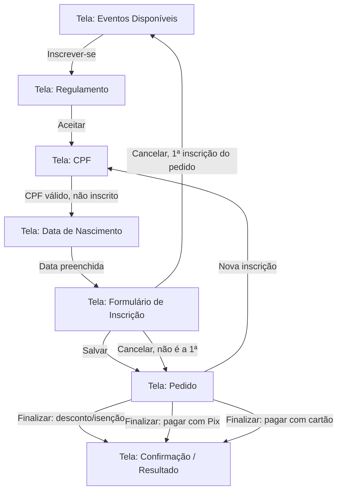

# Especificação Funcional — Front-end EventoWeb Inscrição

## 1. Visão geral

Este documento especifica o front-end de inscrição de eventos do EventoWeb, a ser construído em **React + TailwindCSS**, consumindo a API REST em **C#** do repositório [`eventoweb_inscricao_back`](https://github.com/robsonmbobbi/eventoweb_inscricao_back) (branch `develop`).

Já existe uma implementação de referência em **Flutter** dentro do mesmo repositório do back-end (pasta `front/`), consumindo essa mesma API. Ela foi usada como fonte de verdade para os contratos de endpoints, DTOs e enums descritos neste documento (seção 4), mas o comportamento de tela e a UX podem — e devem — ser revistos livremente no React, respeitando as regras de negócio confirmadas com o analista.

Fluxo macro:



## 2. Arquitetura e stack técnica recomendada

| Camada | Escolha recomendada | Justificativa |
|---|---|---|
| Bundler/dev server | Vite + React + TypeScript | Padrão atual para SPAs React, build rápido, tipagem reduz erros de contrato com a API (enums como inteiros, DTOs). |
| Estilo | TailwindCSS | Já definido pelo time. |
| Roteamento | React Router v6+ | Cada etapa do wizard de inscrição é uma rota (`/eventos`, `/eventos/:idEvento/regulamento`, `/.../cpf`, `/.../nascimento`, `/.../formulario`, `/eventos/:idEvento/pedido`, `/.../resultado`), permitindo voltar/avançar com URL e reload seguro. A escolha de forma de pagamento e o pedido de desconto/isenção acontecem dentro da própria rota de Pedido, sem rota própria. |
| Estado de servidor / cache | TanStack Query (React Query) | Todas as chamadas de API descritas na seção 4 são idempotentes o suficiente para cache/invalidations; simplifica loading/error state por tela. |
| Formulários e validação | React Hook Form + Zod | Formulário grande de inscrição com validação condicional (infantil x adulto); Zod permite schemas condicionais e reuso de validação de CPF/e-mail/celular. O formulário de dados de cartão de crédito da tela de Pedido usa estado local (`useState`) e validação própria (`src/lib/cartao.ts`) — ver seção 5.5. |
| HTTP client | Axios com instância única e interceptor de resposta | O back-end retorna erros como objeto JSON com campo `exception` (GET/PUT) ou `mensagemErro` (POST) — um interceptor centraliza a extração dessa mensagem para exibição uniforme de erro em toda a aplicação. |
| Estado do "pedido" (carrinho) | Zustand (ou Context + useReducer) | O pedido é **inteiramente client-side até a finalização** (não há endpoint de "criar pedido em rascunho" no back — só `POST /pedidos/incluir` no final). Precisa sobreviver a navegação entre telas do wizard, mas pode ser perdido em reload de página (comportamento de carrinho em memória, como no app Flutter). |
| Máscaras de input | `react-imask` (ou biblioteca equivalente) | CPF, celular. |
| Datas | `date-fns` (ou `dayjs`) | Formatação de datas de período de inscrição/realização e conversão para `toISOString()` esperado pelo back. |

### 2.1 Estrutura de pastas sugerida

```
src/
  api/              # client axios + funções por recurso (eventos, inscricoes, pedidos, precos, formasPagamento)
  types/            # DTOs e enums (espelhando a seção 4)
  features/
    eventos/        # tela de listagem de eventos
    inscricao/       # wizard: regulamento, cpf, nascimento, formulario
    pedido/          # carrinho / tela de pedido (inclui forma de pagamento e desconto/isenção)
    pagamento/       # tela de resultado (Pix, cartão, desconto/isenção)
  components/       # componentes compartilhados (inputs mascarados, cards, banners de erro/vazio)
  store/            # estado do pedido (carrinho) em memória
  routes/           # definição de rotas
```

## 3. Convenções transversais

- **Enums são transmitidos como índice inteiro**, não string, em ambas as direções (request e response). A ordem exata de cada enum (seção 4.7) deve ser preservada byte a byte no front — um enum fora de ordem quebra silenciosamente a integração.
- **CPF e celular**: exibidos com máscara, mas enviados à API somente com dígitos (strip de tudo que não for número antes do POST/GET).
- **Datas**: enviadas em ISO 8601 (`toISOString()`); exibidas em formato `dd/mm/aaaa`.
- **Moeda**: valores em `double`, exibidos como `R$ 0.000,00` (`Intl.NumberFormat('pt-BR', { style: 'currency', currency: 'BRL' })`).
- **Erros de API**: sempre extrair a mensagem do campo `exception` (respostas de GET/PUT) ou `mensagemErro` (respostas de POST) e exibir em um componente de alerta padrão — nunca expor stack trace ou payload cru.
- **Persistência do pedido**: o "pedido" é uma lista de inscrições acumuladas em memória no front (não existe endpoint de rascunho no back). Se o usuário atualizar a página no meio do fluxo, o carrinho é perdido e ele reinicia em "Eventos Disponíveis" — **decisão confirmada**: não haverá persistência em `localStorage`/`sessionStorage` nesta versão (ver seção 8).
- **Decisão confirmada sobre o back-end**: o endpoint de formas de pagamento é `GET /api/formaspagamento/listar/{idEvento}` — segue-se o contrato real do controller C#, não o app Flutter de referência (que chama sem `idEvento`, um bug conhecido dele). De forma geral, **o app Flutter está desatualizado e será descontinuado**, então o controller C# é a única fonte de verdade de contrato de API daqui em diante, não o Flutter.

## 4. Contratos de API (mapeados da implementação de referência)

> Base URL configurável via variável de ambiente (equivalente ao `urlApi` do `config.json` do app Flutter). Todas as rotas abaixo já incluem o prefixo `/api`.

### 4.1 Eventos

| Ação | Endpoint | Observações |
|---|---|---|
| Listar eventos disponíveis para inscrição | `GET /api/eventos/listar` | Filtro **já aplicado no servidor**: só retorna eventos dentro do período de inscrição. Lista vazia = nenhum evento disponível (não há flag explícita). |
| Obter evento por id | `GET /api/eventos/obter/{id}` | Usado ao entrar na tela de Pedido. |
| Calcular idade na data do evento | `GET /api/eventos/{idEvento}/obter-idade/{dataNascimento}` | Retorna `{ "idade": <int> }`. |

**DTOEvento**: `id` (int), `nome` (string), `dataInicialInscricao` / `dataFinalInscricao` (período de inscrição), `dataInicialRealizacao` / `dataFinalRealizacao` (período de realização), `idadeMinimaAdulto` (int — idade de corte adulto/infantil), `logotipo` (string base64 — imagem do cartaz), `regulamento` (string HTML).

### 4.2 Pesquisa de pessoa por CPF

| Ação | Endpoint |
|---|---|
| Pesquisar CPF no contexto de um evento | `GET /api/inscricoes/pesquisar/evento/{idEvento}/cpf/{cpf}` |

**Resposta — `DTOInscricaoPesquisaPessoa`**: `situacao` (enum, ver 4.7), `inscricao` (nullable), `pessoa` (nullable).

Regra de decisão (situação → comportamento do front):

| `situacao` | Significado | Comportamento esperado |
|---|---|---|
| `inscricaoRealizada` (1) | CPF já tem inscrição **completa** neste evento | Bloquear o fluxo: exibir mensagem "esta pessoa já está inscrita neste evento" e devolver o foco ao campo CPF para novo valor (tela 1). |
| `inscricaoNoLimbo` (0), com `inscricao != null` | Existe inscrição **incompleta/rascunho** para este evento | Tratar como **edição**: pré-preencher formulário com dados de `inscricao` (incluindo `pessoa` embutida) e, ao salvar, chamar `PUT /inscricoes/atualizar`. |
| `inscricaoNoLimbo` (0) ou `inscricaoNaoExiste` (2), com `pessoa != null` e `inscricao == null` | Pessoa já cadastrada em outro evento/contexto, mas sem inscrição aqui | Pré-preencher apenas os dados pessoais a partir de `pessoa`; ao salvar, `POST /inscricoes/incluir`. |
| `inscricaoNaoExiste` (2), `pessoa == null` | Pessoa nova | Formulário em branco; ao salvar, `POST /inscricoes/incluir`. |

O mesmo endpoint é reaproveitado para a busca do(s) responsável(is) na inscrição infantil (ver 4.4).

### 4.3 Inscrição

| Ação | Endpoint |
|---|---|
| Criar inscrição | `POST /api/inscricoes/incluir` |
| Atualizar inscrição (rascunho existente) | `PUT /api/inscricoes/atualizar` |

**DTOInscricao**: `id` (int, nulo na criação), `tipo` (enum infantil/adulto), `idEvento` (int), `instituicoesEspiritasFrequenta` (string, **campo adulto**), `dormeEvento` (bool, padrão `true`), `nomeCracha` (string, máx. 150, opcional), `observacoes` (string, opcional), `pessoa` (objeto `DTOPessoa`), `responsavel1` / `responsavel2` (`DTOResponsavel`, **campos infantil**), `situacao` (definido pelo servidor).

**DTOPessoa**: `nome`* , `dataNascimento`, `cpf`*, `alergiaAlimentos` (máx. 100), `celular`*, `ehDiabetico` (bool), `ehVegetariano` (bool), `email`*, `sexo` (enum), `usaAdocanteDiariamente` (bool), `uf` (2 letras), `cidade`. (* obrigatórios)

**DTOResponsavel** (só inscrição infantil): `idInscricao` (int, obtido via busca de CPF — deve corresponder a uma inscrição **adulta já existente**), `cpf`, `nome` (derivado da busca, somente leitura).

### 4.4 Preços por inscrição

| Ação | Endpoint |
|---|---|
| Obter preços por faixa etária (data de nascimento) | `GET /api/precosinscricao/evento/{idEvento}/obter/nascimento/{dataNascimento}` |

Resposta: preço já discriminado por forma de pagamento — `{ id, idadeMax, valores: [{ forma: DTOFormaPagamento, preco }] }`.

### 4.5 Formas de pagamento

| Ação | Endpoint |
|---|---|
| Listar formas de pagamento do evento | `GET /api/formaspagamento/listar/{idEvento}` |

**DTOFormaPagamento**: `id`, `nome`, `nrParcelasMinima`, `nrParcelasMaxima`, `tipo` (enum crédito/pix).

> Esta listagem alimenta o seletor de forma de pagamento **dentro da tela de Pedido** (5.5) — não há mais uma tela própria de "Formas de Pagamento". `nrParcelasMinima`/`nrParcelasMaxima` definem as opções do seletor de parcelas exibido quando a forma é cartão de crédito (o seletor só aparece se `nrParcelasMaxima > 1`).

### 4.6 Pedido

| Ação | Endpoint |
|---|---|
| Criar e finalizar pedido (único endpoint) | `POST /api/pedidos/incluir` |

Não existe endpoint de listagem/rascunho de pedido no back — a tela de Pedido é **inteiramente um carrinho client-side**; a chamada única de finalização cria o pedido **e** já retorna as informações de pagamento (QR code Pix, ou o status da cobrança no cartão) na mesma resposta.

**Request — `DTOPedidoInclusao`**: `idEvento` (int, sempre obrigatório), `idsInscricoes` (int[]), `valor` (total, calculado no client somando os preços por forma escolhida), `tipo` (enum `debito` | `desconto` | `isencao`), `idFormaPagamento` (obrigatório só se `tipo == debito`), `nomePagador` / `cpfPagador` / `celularPagador` / `emailPagador` (sempre obrigatórios), `numeroParcelas` (int, só para cartão; `null` nos demais casos), `dadosCartao` (obrigatório quando a forma é cartão de crédito; `null` nos demais casos), `motivo` (obrigatório só se `tipo` for `desconto` ou `isencao`).

**`dadosCartao` — `DTODadosCartaoPedido`** (checkout transparente — o cartão é cobrado na própria chamada): `numeroCartao`, `nomeImpressoCartao`, `mesExpiracao`, `anoExpiracao` (2 ou 4 dígitos), `codigoSeguranca`, `nomeTitular`, `emailTitular`, `cpfOuCnpjTitular`, `cepTitular`, `numeroEnderecoTitular`, `complementoEnderecoTitular` (opcional), `telefoneTitular`. O front envia os campos numéricos só com dígitos (o back também normaliza). O IP do comprador é obtido pelo back-end. **Os dados do cartão nunca são persistidos no front** (nem store, nem `localStorage`, nem `navigate` state).

**Resposta — `DTOResultadoPedido`**: `idPedido`, `valor`, `tipo`, `idFormaPagamento`, `debito` (presente só quando `tipo == debito`): `{ tipoTransacao (enum tipo de pagamento — atenção: chave JSON é "tipoTransacao"), status (enum), imagemQRCodePixBase64, pixCopiaECola, linkPagamento }`.

- `imagemQRCodePixBase64` / `pixCopiaECola`: preenchidos quando `tipoTransacao == pix` (comportamento inalterado).
- Cartão: `status == recebida` quando a cobrança é aprovada na hora (caso normal). Cartão recusado → a API responde erro com a mensagem da operadora e o pedido não é criado (rollback).
- `linkPagamento` (string, URL): apenas **fallback**, para o caso de a cobrança com cartão não ser concluída na hora.

**Regra de desconto/isenção** (confirmada): não há percentual automático. O pedido inteiro é marcado como `desconto` ou `isencao`, com um campo de texto livre `motivo`, coletado na própria tela de Pedido (5.5); a forma de pagamento não é solicitada nesse caso. A avaliação é manual, feita depois pela coordenação — a tela de resultado deve deixar isso explícito ao usuário.

**Regra do pagamento com cartão de crédito** (confirmada): checkout transparente via Asaas. O front coleta os dados do cartão, as parcelas e os dados do titular (por padrão, o próprio responsável pelo pedido; CEP e número do endereço são sempre exigidos) e os envia em `dadosCartao` no mesmo `POST /pedidos/incluir`.

### 4.7 Enums (valores inteiros exatos — preservar ordem)

```
EnumSituacaoPesquisaPessoa: 0=inscricaoNoLimbo, 1=inscricaoRealizada, 2=inscricaoNaoExiste
EnumTipoInscricao:          0=infantil, 1=adulto
EnumSituacaoInscricao:      0=limbo, 1=pendente, 2=aceita, 3=rejeitada
EnumSexo:                   0=masculino, 1=feminino
EnumTipoPedido:              0=debito, 1=desconto, 2=isencao
EnumTipoPagamento:           0=credito, 1=pix
EnumStatusTransacao:         0=pendente, 1=recebida, 2=cancelada
```

## 5. Especificação das telas

### 5.0 Tela: Eventos Disponíveis (home)

**Rota**: `/eventos`
**Objetivo**: ponto de entrada; lista os eventos com inscrições abertas.
**Integração**: `GET /eventos/listar` ao montar a tela.

**Conteúdo por card de evento**:
- Imagem do cartaz (`logotipo`, base64)
- Nome do evento
- Período de inscrição (`dataInicialInscricao` – `dataFinalInscricao`)
- Período de realização (`dataInicialRealizacao` – `dataFinalRealizacao`)
- Comando "Inscrever-se"

**Estados**:
- *Carregando*: skeleton dos cards.
- *Erro de rede*: alerta com opção de tentar novamente.
- *Lista vazia*: estado vazio dedicado — ilustração/ícone representando "nenhum evento no momento" + texto "Não há eventos disponíveis para inscrição no momento." Sem comando de ação (não há o que fazer além de voltar depois).

**Ação "Inscrever-se"**: inicializa o estado do pedido (carrinho vazio) para o `idEvento` selecionado e navega para a tela de Regulamento.

### 5.1 Tela: Regulamento

**Rota**: `/eventos/:idEvento/regulamento`
**Objetivo**: apresentar o `regulamento` (HTML) do evento e obrigar aceite antes de prosseguir.
**Integração**: reaproveita o `DTOEvento` já obtido (ou `GET /eventos/obter/{id}` se acessado diretamente).

**Conteúdo**: título do evento, corpo do regulamento renderizado a partir do HTML retornado pela API, checkbox "Li e aceito o regulamento", comando "Continuar" (desabilitado até marcar o checkbox), comando "Voltar" (retorna a 5.0).

> Nota: esta etapa não constava na visão geral original do fluxo, mas existe no app de referência e foi confirmada com o analista para manter paridade. Deve ser exibida uma única vez por sessão de inscrição (não deve reaparecer entre inscrições do mesmo pedido).

### 5.2 Tela: CPF

**Rota**: `/eventos/:idEvento/cpf`
**Objetivo**: identificar a pessoa a ser inscrita.
**Campos**: CPF (input mascarado `000.000.000-00`).
**Comando**: "Prosseguir".

**Regras**:
1. Se o campo estiver vazio ao clicar em Prosseguir → mensagem de alerta inline, não avança, não chama API.
2. Se preenchido mas com formato/dígito verificador de CPF inválido → mensagem de alerta inline, não chama API.
3. Se válido → `GET /inscricoes/pesquisar/evento/{idEvento}/cpf/{cpf}`.
   - `situacao == inscricaoRealizada` → modal/mensagem "Esta pessoa já está inscrita neste evento.", campo CPF é limpo e recebe foco novamente (tela permanece a mesma).
   - Qualquer outra situação → guarda o resultado da pesquisa no estado do wizard e navega para 5.3.

**Estados**: loading no botão durante a chamada; erro de rede exibido como alerta reaproveitando o interceptor da seção 3.

### 5.3 Tela: Data de Nascimento

**Rota**: `/eventos/:idEvento/nascimento`
**Pré-condição**: vem sempre depois de 5.2 com um resultado de pesquisa em estado.

**Campos**:
- CPF — **desabilitado**, valor vindo da tela anterior.
- Data de nascimento — input de data, **sempre editável** (diferente do CPF, que fica desabilitado).
  - **Pré-preenchido** quando a pesquisa trouxe `pessoa` (ou `inscricao.pessoa`) com `dataNascimento` preenchida (pessoa já cadastrada e não inscrita, ou inscrição em rascunho) — o usuário pode alterar o valor mesmo assim (ex.: corrigir um cadastro antigo incorreto).
  - **Vazio** quando a pessoa não existe na base.

**Comando**: "Prosseguir".

**Regras**:
1. Se data de nascimento vazia → mensagem de alerta, não avança.
2. Se preenchida → `GET /eventos/{idEvento}/obter-idade/{dataNascimento}` para obter a idade na data do evento; comparar com `idadeMinimaAdulto` do evento para definir `tipo` (infantil/adulto) que será usado para condicionar os campos da tela seguinte.
3. Avança para 5.4 carregando no estado do wizard: CPF, data de nascimento, idade calculada, tipo de inscrição resultante, e os dados já conhecidos de `pessoa`/`inscricao` (para pré-preenchimento).

**Comando "Voltar"**: retorna a 5.2 (permite corrigir o CPF).

### 5.4 Tela: Formulário de Inscrição

**Rota**: `/eventos/:idEvento/inscricao/formulario`
**Objetivo**: capturar/confirmar os dados da inscrição.

**Campos sempre desabilitados** (herdados das telas anteriores): CPF, Data de nascimento.

**Campos comuns** (`DTOPessoa` + `DTOInscricao`):
- Nome completo* 
- Nome do crachá (opcional, máx. 150 caracteres, texto de apoio "Nome que aparecerá no seu crachá")
- Sexo* (Masculino/Feminino)
- E-mail*
- Celular* (mascarado)
- Cidade*
- UF* (select com as 27 UFs)
- Dorme no evento? (checkbox/switch, padrão marcado)
- Alergia a alimentos (opcional, máx. 100)
- É diabético? (checkbox)
- É vegetariano? (checkbox)
- Usa adoçante diariamente? (checkbox)
- Observações (opcional, textarea, até ~4 linhas)

**Campos exclusivos — inscrição adulto** (`tipo == adulto`):
- Instituições espíritas que frequenta (opcional, texto livre)

**Campos exclusivos — inscrição infantil** (`tipo == infantil`):
- CPF do Responsável 1* — input com botão "Buscar": chama o mesmo endpoint de pesquisa de CPF (4.2) restrito a inscrições **adultas já existentes** neste evento; se não encontrar, exibir erro "Não encontramos nenhuma inscrição com esse CPF para ser o responsável!" e bloquear o avanço até resolver; se encontrar, preenche nome do responsável (somente leitura) e guarda `idInscricao`.
- CPF do Responsável 2 (opcional) — mesmo mecanismo de busca, sem bloqueio se deixado vazio.

**Comandos**: "Salvar" e "Cancelar".

**Regra de "Salvar"**:
- Validar campos obrigatórios (ver acima) antes de chamar a API.
- Se a pesquisa de CPF (5.2) trouxe `situacao == inscricaoNaoExiste` → `POST /inscricoes/incluir`.
- Caso contrário (rascunho existente, `inscricaoNoLimbo` com `inscricao != null`) → `PUT /inscricoes/atualizar`.
- Sucesso → adiciona a inscrição criada/atualizada ao carrinho do pedido (estado em memória) e navega para 5.5 (Pedido).
- Erro de validação retornado pela API → exibir mensagem (extraída conforme seção 3) sem sair da tela.

**Regra de "Cancelar"**:
- Se esta **não** é a primeira inscrição do pedido atual (já existe ao menos uma inscrição no carrinho) → retorna para 5.5 (Pedido), descartando os dados não salvos desta inscrição.
- Se **é** a primeira inscrição do pedido (carrinho vazio) → retorna para 5.0 (Eventos Disponíveis), descartando o carrinho.

### 5.5 Tela: Pedido

**Rota**: `/eventos/:idEvento/pedido`
**Objetivo**: revisar as inscrições acumuladas no carrinho e concluir — pagamento, desconto ou isenção — em uma única tela.

**Conteúdo**:
- Lista de inscrições do pedido: nome, tipo (infantil/adulto), status de preenchimento, valor a pagar de cada uma (calculado sob demanda — ver nota abaixo).
- Comando "Nova Inscrição" → volta ao início do wizard (5.1 ou 5.2, a depender de já ter aceitado o regulamento nesta sessão) para adicionar outra pessoa ao mesmo pedido.
- Seletor de intenção: **"Pagar agora"** / **"Solicitar desconto"** / **"Solicitar isenção"**.
  - **"Pagar agora"** (`GET /formaspagamento/listar/{idEvento}` ao selecionar, se ainda não carregado):
    - Seletor de forma de pagamento (`nome` de cada `DTOFormaPagamento`: Pix ou Cartão de Crédito).
    - Ao escolher a forma: recalcular o valor total do pedido chamando `GET /precosinscricao/evento/{idEvento}/obter/nascimento/{dataNascimento}` para **cada inscrição** do carrinho e somando o valor correspondente à forma escolhida.
    - Ao escolher **crédito**: formulário do cartão (número, nome impresso, validade `MM/AA`, CVV), seletor de parcelas (`nrParcelasMinima`..`nrParcelasMaxima`, só se o máximo for > 1), checkbox "O titular do cartão é o responsável pelo pedido" (marcado por padrão; desmarcado, pede nome, CPF/CNPJ, telefone e e-mail do titular), CEP, número e complemento do endereço do titular. Validação no client: Luhn, validade não vencida, CVV com 3–4 dígitos.
    - Card "Dados do responsável pelo pedido" (sempre exigido, exibido **antes** do card "Como deseja seguir?"): nome, CPF, celular, e-mail.
  - **"Solicitar desconto" / "Solicitar isenção"**: nenhuma forma de pagamento é exibida; mostrar campo de texto livre **"Motivo"** (obrigatório).
- Total do pedido em destaque.
- Comando "Finalizar".

> **Nota sobre valores por inscrição**: a API só devolve valor por forma de pagamento (`GET /precosinscricao/.../nascimento/{data}`), então o "valor a pagar" exibido nesta tela na prática depende da forma de pagamento — se ainda não escolhida, exibir uma faixa/"a definir" ou calcular com a forma padrão (ex.: Pix) só para referência, atualizando assim que uma forma for selecionada.

**Regra de "Finalizar"** — sempre um único `POST /pedidos/incluir`, variando o corpo conforme a seleção:
- "Pagar agora" → `tipo = debito`, `idFormaPagamento` da forma escolhida, dados do pagador; para crédito, também `numeroParcelas` e `dadosCartao`. Sucesso → navega para 5.6 (Resultado) levando o `DTOResultadoPedido` retornado.
- "Solicitar desconto"/"Solicitar isenção" → `tipo` correspondente e `motivo` preenchido (sem forma de pagamento). Sucesso → navega direto para 5.6 (Resultado).
- Validação de campos obrigatórios (dados do pagador para pagamento; motivo para desconto/isenção) acontece no client antes de chamar a API.
- **Erro de validação/pagamento retornado pela API** → exibir mensagem (extraída conforme seção 3), permanecer na tela para correção (não perder os dados digitados).

**Estado vazio**: se o carrinho está vazio (ex.: usuário voltou de um cancelamento), a tela de Pedido não deveria ser alcançável — o fluxo redireciona para 5.0.

### 5.6 Tela: Resultado / Confirmação

**Rota**: `/eventos/:idEvento/resultado`
**Objetivo**: informar o desfecho do pedido, variando por `tipo` e (quando `debito`) por forma de pagamento.

| Caso | Conteúdo |
|---|---|
| `tipo == debito` e forma **Pix** | QR code (`imagemQRCodePixBase64`) + código copia-e-cola (`pixCopiaECola`) + instrução de pagamento + status (`status` da transação). |
| `tipo == debito` e forma **crédito** | `status == recebida`: "Pagamento confirmado" com valor e parcelamento. `pendente`: "Pagamento em processamento" (ou, se vier `linkPagamento`, o link com botão "Copiar link"). `cancelada`: "Pagamento não aprovado". |
| `tipo == desconto` ou `tipo == isencao` | Mensagem informando que a solicitação será avaliada pela coordenação e que o contato será feito em breve — sem informações de pagamento. |

**Comando final**: "Concluir" → limpa o estado do pedido/carrinho e retorna à tela de Eventos Disponíveis (5.0).

## 6. Fluxo de cancelamento (consolidado)

- Cancelar no Formulário de Inscrição (5.4):
  - Pedido com 0 inscrições confirmadas → volta para Eventos Disponíveis (5.0), descarta o carrinho.
  - Pedido com 1+ inscrições já confirmadas → volta para a tela de Pedido (5.5), mantém o carrinho existente, descarta apenas a inscrição em edição.
- Não há cancelamento nas telas de CPF/Data de Nascimento além do "Voltar" simples entre elas (5.3 → 5.2).
- Não há uma tela separada de pagamento a cancelar: a escolha de forma de pagamento e o pedido de desconto/isenção acontecem dentro da própria tela de Pedido (5.5), e nenhuma chamada de API é feita até o clique em "Finalizar".

## 7. Componentes/estados compartilhados

- **Banner/alerta de erro de API**: usado em todas as telas para exibir a mensagem extraída de `exception`/`mensagemErro`.
- **Estado vazio**: componente reutilizável (ilustração + título + descrição), usado na tela de Eventos (5.0) e disponível para outros vazios futuros.
- **Loading**: skeleton para listas (eventos, formas de pagamento), spinner em botões durante submissão.
- **Inputs mascarados**: CPF, celular — componente único parametrizável.

## 8. Decisões confirmadas

1. **Cálculo de idade**: o front não replica nenhuma lógica de idade — apenas consome `GET /eventos/{idEvento}/obter-idade/{dataNascimento}` e usa o valor retornado para decidir `tipo` (infantil/adulto) comparando com `idadeMinimaAdulto`.
2. **Edição de data de nascimento**: o campo é **sempre editável** na tela 5.3, esteja pré-preenchido (pessoa reconhecida pela pesquisa de CPF) ou vazio (pessoa nova) — diferente do CPF, que permanece desabilitado.
3. **Persistência do carrinho**: **sem persistência** nesta versão — o pedido continua 100% em memória no front; reload de página reinicia o fluxo em "Eventos Disponíveis".
4. **Endpoint de formas de pagamento**: seguir o **contrato real do controller C#** (`/api/formaspagamento/listar/{idEvento}`, com `idEvento` na rota). O app Flutter de referência está desatualizado nesse ponto (chama sem `idEvento`) e **será descontinuado** — de forma geral, o controller C# é a fonte de verdade de contrato de API a partir de agora, não o Flutter.
5. **Cartão de crédito — checkout transparente**: o cartão é cobrado na própria chamada `POST /pedidos/incluir`, com `dadosCartao` + `numeroParcelas`. Aprovado → `debito.status = recebida`. `linkPagamento` existe em `DTODebitoPedido` apenas como fallback.
6. **Reenvio do link em caso de falha de envio**: fora do escopo deste front de inscrição — essa funcionalidade será tratada em um app de secretaria (back-office) separado. Este front só precisa exibir o link (quando vier como fallback) e o botão "Copiar link" na tela de Resultado.
